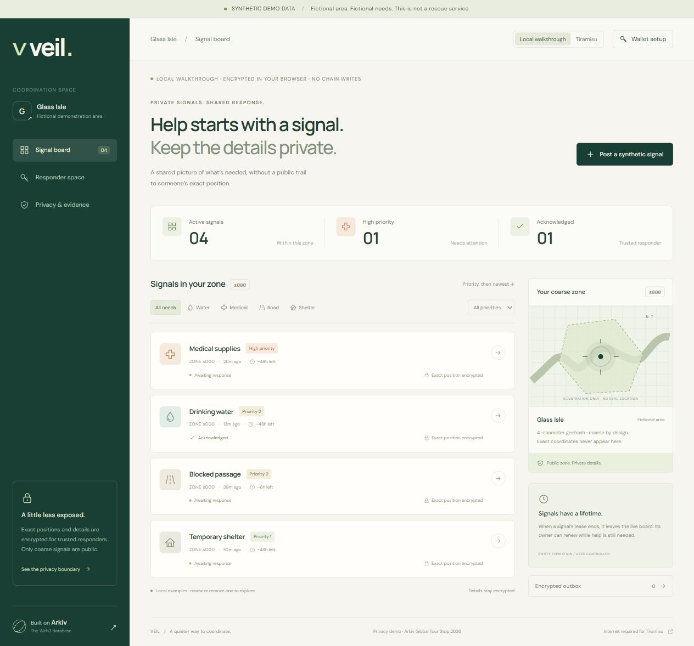

# Veil

[Open the public app](https://veil-glass-isle.exactsun.chatgpt.site) · [Setup handoff](arkiv/setup.md)

**Private signals. Shared response.** A synthetic coordination demo for Arkiv: Global Tour Stop — Privacy (Global).

**Synthetic demo data only. Fictional Glass Isle, fictional coordinates, fictional needs. This is a demo, not a rescue service.** No free-text incident form or device geolocation.

## Implemented

Responsive public board; separate local walkthrough and Tiramisu mode; WebCrypto AES-256-GCM envelope encryption with independent ECDH/HKDF wrappers per responder; creator-validated keys and acknowledgements; paginated SDK queries; per-type Entity Expiration; owner-only Lifetime Extension and removal; readonly entities; WebSocket entity events without fromBlock, filtered in the browser.

Also: temporary browser wallet/faucet setup, optional injected-wallet signing, non-extractable responder CryptoKeys in IndexedDB, ciphertext-only offline outbox, cached app shell, session evidence export, tests, and a CLI acceptance script.

**Verified on Tiramisu (18 Oct 2026):** a CLI run and a separate browser run created, read, decrypted, acknowledged, renewed and deleted real entities. Transaction hashes and wallet roles are in [evidence.md](arkiv/evidence.md) and [transactions.json](arkiv/transactions.json). **Not yet done:** public deployment of the redesigned app, demo video, Devfolio submission. Entity expiry running out on its own and offline outbox submission have not been observed.

## Run and verify

Node >=20; tested on Node 24.18.0 / npm 11.16.0, Windows PowerShell.

```sh
npm ci
npm test
npm run verify:sdk
npm run build
npm run dev
```

Open http://127.0.0.1:4173. WebCrypto needs HTTPS or localhost. The dev server serves dist; rebuild after edits. Deploy dist as static assets. SDK 0.8.1 and viem 2.57.7 are bundled, not loaded from a CDN. `npm run verify:rpc` attempts a read-only public chain-ID/query probe.

## No-login walkthrough

1. The default **Local walkthrough** explicitly states there are no chain writes. Its four fictional signals are encrypted in your browser.
2. Filter by need/priority; open a signal. Exact details remain hidden.
3. **Decrypt as walkthrough responder** unwraps a recipient data key and decrypts locally. Hide details again and inspect the public envelope.
4. Acknowledge a signal; renew the six-hour road fixture to 24 hours; remove a local signal with “I'm safe”. These are local operations only.
5. Read **Privacy & evidence**, then switch to **Tiramisu** to attempt the actual board. Network/setup failures stay visible and are never replaced with fake chain data.

## Real Tiramisu setup

1. In **Wallet setup**, generate a temporary browser wallet and copy its public funding address. Private signing keys stay in memory; reloading loses ownership control. Never put real assets in it.
2. Obtain test GLM at [Arkiv Hub](https://hub.arkiv.network). If its faucet funds only the connected wallet, transfer test GLM to the temporary address or use **Connect browser wallet**. Hub sign-in, registration, captcha, and funding are not yet verified here.
3. Configure the responder organization wallet's PUBLIC address, then rebuild/redeploy:

   ```sh
   node scripts/configure-responders.mjs <public-org-address>
   npm run build
   ```

   Multiple public org addresses can be supplied. Trust is anchored to that source configuration, not a visitor-supplied organization field.
4. Connect the approved wallet in Tiramisu mode, create a local responder encryption key, then publish its public half. The private key stays non-extractable in this browser's IndexedDB; clearing storage loses it. A compromised browser can still use the key.
5. With a funded reporter wallet, post a built-in fictional scenario. Decrypt on the recipient device and acknowledge from an approved wallet. Renew to a strictly later expiry or remove the live entity. Export session evidence before reload.

**RPC quota:** the anonymous public endpoint shares a small query budget that normal use exhausts (HTTP 429 ANON_COST_LIMITED). Use a [Hub access key](https://docs.arkiv.network/start-here/access-keys/). Never commit it. `npm run dev` (scripts/serve.mjs) exposes a same-origin `/rpc` gateway that adds the key server-side from `ARKIV_ACCESS_KEY`, so it never reaches the browser: build with `RPC_PROXY=1 npm run build` and start with `node --env-file=.env scripts/serve.mjs`. A static host needs the same gateway (for example a Worker) or a key baked into the bundle with `BAKE_KEY=1`, which every visitor can read. Default builds are keyless.

### CLI acceptance and durable evidence

Privately set environment variables `REPORTER_PRIVATE_KEY`, `RESPONDER_PRIVATE_KEY`, and optional `ARKIV_ACCESS_KEY` for funded throwaway wallets. Configure the responder's public address first. Do not send secrets to chat or commit them. Run:

```sh
npm run bootstrap
```

The script checks reads and funds before writes, publishes a public responder key, creates/reads/decrypts a synthetic signal, acknowledges it, extends its lease, and acknowledges the renewed lease. It appends each successful transaction to arkiv/transactions.json before proceeding; inspect partial results before retrying. The private ECDH key is process-local and not exported, so the browser cannot subsequently decrypt that CLI fixture. Use the browser flow for the two-device video. The script has not run against funded accounts yet.

## Privacy and operating limits

Public: coarse zone, need, priority, time, namespace, creator/owner wallets, expiry, transaction timing, payload sizes, recipient-key references, and ack linkage. Four-character geohash is still metadata, approximately 39 by 20 km at the equator. Zone s000 is an arbitrary fixture; exact positions use an invented local grid.

Exact positions/details stay off Arkiv in plaintext; encrypted copies go on Arkiv. Wallet secrets, private responder keys, and raw AES keys stay off Arkiv. Encryption provides confidentiality against public readers, not anonymity, forward secrecy, guaranteed delivery, or protection from authorized/compromised responders. Acknowledgement does not mean help arrived. Expiration/deletion affect live availability, not history or downloaded copies.

Arkiv requires internet. The PWA queues ciphertext during intermittent connectivity; submission needs an open page and funded signer on reconnect. It revalidates original recipients; retired keys require a new encrypted draft. No total-cellular-shutdown, background-signing, automatic-renewal, or historical-erasure claim is made.

## Why Arkiv

Independent responders can query shared ciphertext and verify acknowledgement creators without our database API. Postgres/our API would put availability under one operator. IPFS alone needs discovery/live-lease indexing; a subgraph needs a separate write source. These alternatives can implement similar workflows with different trust and infrastructure; no impossibility claim is made. Arkiv is the primary shared data layer; plaintext and secret keys stay local.

## Submission

See [schema](arkiv/schema.md), [friction](arkiv/friction.md), [verification](arkiv/verification.md), [evidence](arkiv/evidence.md), [setup](arkiv/setup.md), [video script](arkiv/demo-script.md), [Devfolio draft](arkiv/devfolio-draft.md), and [gate status](arkiv/submission-status.md).

This project directory began empty on 17 October 2026. App/integration code was written during this session. Third-party dependencies: Arkiv SDK, viem, esbuild, and test-only fake-indexeddb; their licenses remain applicable. No pre-existing project components were reused here. The builder must review and disclose any additional reused work and baseline commit SHA before submitting.

Deadline: **18 October 2026, 23:59 London/Lagos (22:59 UTC)**. Keep deployment available through 23 October. Do not rewrite history after deadline. A public app alone is insufficient: real Arkiv use, public MIT repo, wallet/transaction evidence, <=3-minute video, and complete Devfolio answers are required.

Background photo: "Green cliffs in Ireland" by Jon Sullivan, public domain ([Wikimedia Commons](https://commons.wikimedia.org/wiki/File:Green_cliffs_in_Ireland.jpg)), saved as public/img/glass-isle.jpg. Decorative only; it is not Glass Isle or any real incident location.

License: MIT. No analytics or location API is used. Typography loads Google Fonts; that provider may observe ordinary font-request IP/timing metadata. Signal payloads and keys are not sent to it.


